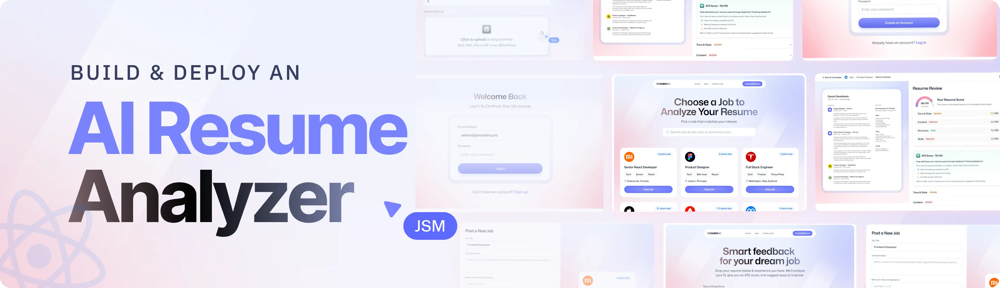

<div align="center">
  <br />
      
  <br />

  <div>
    
    
    
    
  </div>

  <h3 align="center">AI Resume Analyzer</h3>

  <div align="center">
    AI-powered resume analysis platform for ATS scoring, skill matching, and personalized career feedback.
  </div>
</div>

## 📋 <a name="table">Table of Contents</a>

1. ✨ [Introduction](#introduction)
2. ⚙️ [Tech Stack](#tech-stack)
3. 🔋 [Features](#features)
4. 🤸 [Quick Start](#quick-start)
5. 🚀 [Future Enhancements](#more)

## <a name="introduction">✨ Introduction</a>

AI Resume Analyzer is a smart web application that helps candidates evaluate their resumes against job or internship descriptions. The platform uses AI to analyze resume content, calculate ATS compatibility scores, identify matching skills, and generate personalized feedback for improvement.

The goal is to help students and job seekers optimize their resumes and improve their chances of securing internships and employment opportunities.

## <a name="tech-stack">⚙️ Tech Stack</a>

* **React** – Component-based frontend library for building dynamic user interfaces.
* **React Router v7** – Client-side routing and navigation.
* **Puter.js** – Authentication, storage, and AI integration.
* **Tailwind CSS** – Utility-first CSS framework for responsive UI design.
* **TypeScript** – Strongly typed JavaScript for better maintainability.
* **Vite** – Fast development server and build tool.
* **Zustand** – Lightweight state management solution.

## <a name="features">🔋 Features</a>

👉 **Resume Upload & Storage** – Upload and manage multiple resumes securely.

👉 **AI-Powered Resume Analysis** – Analyze resume content using AI models.

👉 **ATS Score Generation** – Evaluate resumes based on ATS-friendly criteria.

👉 **Skill Matching** – Compare candidate skills against job descriptions.

👉 **Personalized Feedback** – Receive actionable suggestions for improvement.

👉 **Responsive Design** – Optimized for desktop, tablet, and mobile devices.

👉 **Modern UI/UX** – Clean and intuitive interface built using Tailwind CSS.

👉 **Reusable Architecture** – Modular and maintainable code structure.

## <a name="quick-start">🤸 Quick Start</a>

Follow these steps to set up the project locally on your machine.

### Prerequisites

Make sure you have the following installed:

* Git
* Node.js
* npm (Node Package Manager)

### Cloning the Repository

```bash
git clone https://github.com/KushalPA15/AI_Resume_Analyzer.git
cd AI_Resume_Analyzer
```

### Installation

```bash
npm install
```

### Running the Project

```bash
npm run dev
```

Open `http://localhost:5173` in your browser to view the application.

## <a name="more">🚀 Future Enhancements</a>

* Internship recommendation engine
* Resume ranking and comparison
* Skill-gap analysis
* Recruiter dashboard
* Interview preparation suggestions
* Advanced analytics and reporting
